# TOY-CV25

> **This is a showcase of a toy project.** It shows what the project does, what it achieved and how it was built. The package is here in its real layout, but only its generic parts are published as code. The parts that are specific to the chip are outlines: signatures and descriptions, without the code. Nothing in this repository may be used or reused (see [LICENSE](LICENSE)). It is not affiliated with Ambarella, Axis or Ultralytics.

## What it is

A converter, written in Python, that takes a YOLOv5n or YOLOv5s object detector and turns it into a network that runs on the AI accelerator of the Ambarella CV25. That chip sits inside a number of AXIS security cameras.

```
cv25yolo yolov5n.onnx -o out/ --calib images/
```

One command takes the ONNX export of a model, at an input size of your choice, and writes:

- `model.bin`: the network binary. The camera's own inference service (larod) loads it and runs it on the accelerator.
- `model_quantized.onnx`: the same quantized network as a standard ONNX file, so the effect of quantization can be previewed on a PC with onnxruntime before anything goes to a camera.
- `model.json`: what an application needs to use the binary (input size, output shapes and number formats, anchors).

The converter needs only numpy, onnx, onnxruntime and Pillow. It was tested on an AXIS M4216-V with AXIS OS 11.4.

## Results



All 24 combinations below were converted, run on the camera and checked against the original float model. The time is the mean execution time per frame that larod reports.

| Input (height x width) | YOLOv5n | YOLOv5s |
|---|---|---|
| 320 x 256 | 26 ms | 69 ms |
| 256 x 320 | 29 ms | 81 ms |
| 320 x 320 | 35 ms | 99 ms |
| 352 x 352 | 41 ms | |
| 384 x 384 | 45 ms | |
| 416 x 416 | 53 ms | 150 ms |
| 448 x 448 | 59 ms | |
| 480 x 480 | 66 ms | |
| 384 x 640 | 70 ms | 196 ms |
| 640 x 480 | 86 ms | 240 ms |
| 480 x 640 | 88 ms | 243 ms |
| 640 x 640 | 116 ms | 325 ms |
| 544 x 960 | 129 ms | 393 ms |
| 960 x 544 | 150 ms | 464 ms |

A YOLOv5n retrained with 1 class and with 10 classes, and an export with built-in non-maximum suppression, run as well.

**Accuracy:** The chip computes with 8-bit and 16-bit integers, and the converter does nothing clever to win back what that costs. Over the models above, 82 to 100 % of the camera's detections match a detection of the float model, so it rarely invents objects. It does miss some: on 4 models with 4 images each, the camera found 34 of the 71 objects that the float model found.

## How it works

```
model.onnx
   |
   |  1. read       the YOLOv5 graph, from ONNX into a list of layers
   |  2. split      layers that are too large for the accelerator, into smaller ones
   |  3. lower      every layer into operations that the accelerator has
   |  4. quantize   choose an integer number format for every tensor and weight
   |  5. generate   cut the network into pieces that fit the accelerator, write each as a program
   |
   v
model.bin
```

1. **Read.** The body of the network becomes a list of layers. The last part of YOLOv5's Detect head (box arithmetic and non-maximum suppression) is cheap, and it stays on the CPU.
2. **Split.** Some layers can be too large for the accelerator at once. They are split into parts whose results are combined again.
3. **Lower.** Each layer is rewritten into the operations that the accelerator offers. A layer it has no operation for is built from simpler ones.
4. **Quantize.** A float emulator runs sample images through the network and records the range of every tensor. Each tensor then gets an 8-bit format, or a 16-bit one where 8 bits cannot hold its range.
5. **Generate.** The accelerator's memory is small, so the network runs as a chain of pieces. A search cuts the network: each piece grows for as long as it fits, and the search steps back when a cut turns out to be one the chip does not run correctly. Each piece is then written as a program for the accelerator.

## How it was built

- **The device as the judge.** Every rule that the code generator follows was confirmed by running binaries on the camera. A broken rule shows up in one of four ways: the runtime rejects the binary, the output holds stale data, the output differs from run to run, or the accelerator hangs. Each rule is written down next to the code that applies it, with what happens when it is broken.
- **Golden tests.** 28 models are rebuilt on every change and compared byte for byte with binaries that ran correctly on the camera. A change that alters a binary is only accepted after a run on the device.
- **A readable rewrite, checked byte for byte.** The research version of the compiler was dense. It was rewritten for readability (plain functions, full-word names, a docstring on every function), and the rewrite produces the same 28 binaries, apart from the names of the tensors. On the camera, four of them gave outputs identical to the research version's.
- **A quantization preview on the PC.** The quantized network is also exported as a standard ONNX file with QuantizeLinear / DequantizeLinear pairs. Its output tensors correlate 0.95 to 0.99 with what the camera returns, so most quantization questions can be answered without a device.
- **Tests that need no data.** Besides the golden tests, the test suite builds a tiny synthetic network and converts it end to end, so it runs anywhere in a fraction of a second.

In numbers: the full project is about 4,600 lines of Python in 27 modules, with 43 tests.

## What is in this repository

The package has the layout of the full project, except that the 12 modules of the code generator are shown as one. A function is published in one of two ways:

- **In full:** the code of the full project.
- **As an outline:** the signature, the types and a description of what the function does. Its body is `raise NotImplementedError("not published")`.

Left out entirely: some internal helpers, the constants that hold chip limits, and the notes on the binary format. In the published code, a few lines are changed or cut where they would give away chip details.

| Path | Content | Lines in the full project | Published |
|---|---|---|---|
| [`src/cv25yolo/convert.py`](src/cv25yolo/convert.py) | The pipeline, step 1 to 5 | 140 | in full |
| [`src/cv25yolo/compiler/onnx_import.py`](src/cv25yolo/compiler/onnx_import.py) | Step 1: read a YOLOv5 ONNX export into layers | 287 | in full |
| [`src/cv25yolo/compiler/passes.py`](src/cv25yolo/compiler/passes.py) | Step 2: split layers that are too large | 244 | partly |
| [`src/cv25yolo/compiler/lower.py`](src/cv25yolo/compiler/lower.py) | Step 3: lower layers into the accelerator's operations | 241 | partly |
| [`src/cv25yolo/compiler/quantize.py`](src/cv25yolo/compiler/quantize.py) | Step 4: calibration and the choice of number formats | 396 | partly |
| [`src/cv25yolo/compiler/emulator.py`](src/cv25yolo/compiler/emulator.py) | The float emulator used for calibration | 112 | partly |
| [`src/cv25yolo/compiler/quantized_onnx.py`](src/cv25yolo/compiler/quantized_onnx.py) | The quantized network as a standard ONNX file | 194 | outline |
| [`src/cv25yolo/compiler/codegen.py`](src/cv25yolo/compiler/codegen.py) | Step 5: cut the network into pieces and write the binary | about 2,700, in 12 modules | outline |
| [`src/cv25yolo/compiler/records.py`](src/cv25yolo/compiler/records.py) | The records passed from step to step | 126 | partly |
| [`src/cv25yolo/image.py`](src/cv25yolo/image.py), [`cli.py`](src/cv25yolo/cli.py) | Letterboxing, the command line | 73 | in full |
| [`examples/decode.py`](examples/decode.py) | The Detect head on the CPU: box arithmetic and non-maximum suppression | 131 | partly |
| [`examples/check.py`](examples/check.py) | Compare the detections of the float and the quantized model | 97 | in full |
| [`tests/`](tests) | Tests of the published parts on a tiny synthetic network, and the golden test with its 28 cases | | |

"Partly" means that the generic functions are in full and the chip-specific ones are outlines.

The tests of the published parts need no model and no camera:

```
pip install -e ".[dev]"
pytest
```

The 28 golden tests are skipped: they need the models, and the steps that are outlines here. For the same reason the `cv25yolo` command stops at the first outlined step.

The full project is in a private repository.

## Licence

Published for viewing only. See [LICENSE](LICENSE).
